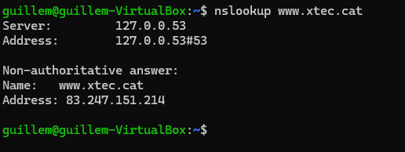
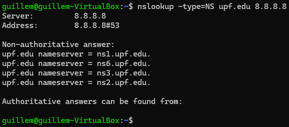
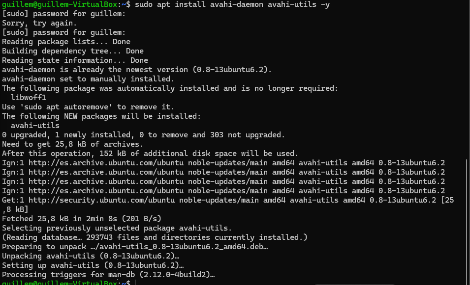
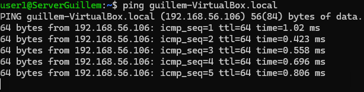
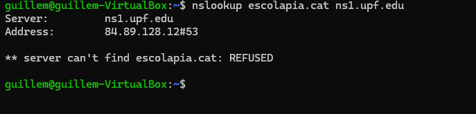
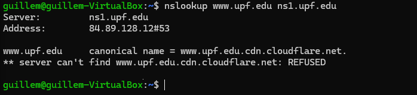
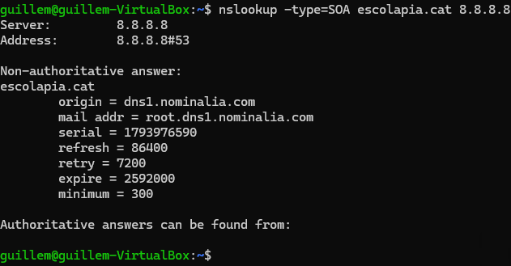
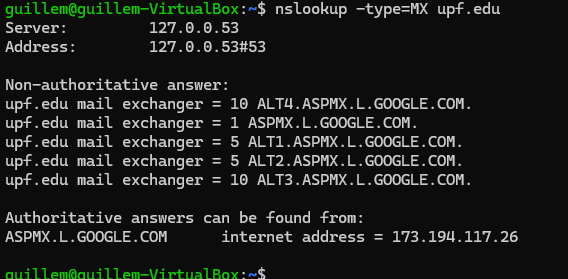

# Pràctica de consultes DNS i mDNS


## 1. Consulta la IP de la pàgina www.xtec.cat. Comprova que la resposta és no-autoritativa.

**Explicació:**  
La consulta retorna l'adreça IP `83.247.151.214`. A la sortida apareix `Non-authoritative answer`, que indica que la resposta no prové directament del servidor DNS autoritatiu del domini, sinó del servidor DNS consultat.



**Comanda:**
```bash
nslookup www.xtec.cat
```

## 2. Fes una consulta usant el servidor de Google 8.8.8.8 per conèixer el NS (servidor de noms) del domini upf.edu.

**Explicació:**  
S'utilitza el servidor DNS públic de Google (`8.8.8.8`) per consultar els registres NS del domini `upf.edu`. La resposta mostra els servidors de noms `ns1.upf.edu`, `ns6.upf.edu`, `ns3.upf.edu` i `ns2.upf.edu`. La resposta és no autoritativa perquè la consulta s'ha fet a Google DNS i no directament a un servidor autoritatiu de la UPF.



**Comanda:**
```bash
nslookup -type=NS upf.edu 8.8.8.8
```

## 3. Fes la consulta usant un dels servidors de noms de upf.edu de la pàgina www.upf.edu. Comprova com ara la resposta sí és autoritativa.

**Explicació:**  
La consulta s'envia directament al servidor `ns1.upf.edu`, identificat a l'apartat anterior. La resposta mostra que `www.upf.edu` és un àlies (CNAME) de `www.upf.edu.cdn.cloudflare.net`, però el servidor retorna `REFUSED` quan intenta resoldre aquest nom. Per tant, aquesta captura no confirma una resposta autoritativa correcta: mostra que el servidor ha rebutjat la consulta.



**Comanda:**
```bash
nslookup www.upf.edu ns1.upf.edu
```

## 4. Consulta els dominis de correu de upf.edu.

**Explicació:**  
La consulta demana els registres MX (*Mail Exchange*) del domini `upf.edu`. Aquests registres indiquen quins servidors reben el correu electrònic del domini. A la captura apareixen diversos servidors de correu de Google, com ara `ALT4.ASPMX.L.GOOGLE.COM` i `ASPMX.L.GOOGLE.COM`, amb les seves prioritats.



**Comanda:**
```bash
nslookup -type=MX upf.edu
```

## 5. Comprova que usant el servidor de noms de la UPF no pots fer una consulta del domini escolapia.cat.

**Explicació:**  
La consulta s'envia al servidor DNS `ns1.upf.edu` per demanar informació del domini `escolapia.cat`. El resultat mostra `REFUSED`, és a dir, el servidor rebutja la consulta i no proporciona la resolució del domini. Això concorda amb el que demana aquest apartat.



**Comanda:**
```bash
nslookup escolapia.cat ns1.upf.edu
```

## 6. Mostra el registre SOA del domini escolapia.cat.

**Explicació:**  
La consulta mostra el registre SOA (*Start of Authority*) del domini `escolapia.cat`. A la captura es veu que el servidor principal és `dns1.nominalia.com` i que el servidor de correu de referència és `root.dns1.nominalia.com`. També s'hi mostren el número de sèrie de la zona i els valors de refresc, reintent, expiració i TTL mínim.



**Comanda:**
```bash
nslookup -type=SOA escolapia.cat 8.8.8.8
```

## 7. Fes una consulta mDNS entre dues màquines virtuals.

**Explicació de la instal·lació:**  
S'instal·len els paquets `avahi-daemon` i `avahi-utils`, que permeten utilitzar mDNS a Linux. Aquest servei facilita la resolució de noms dins de la xarxa local sense haver de configurar un servidor DNS convencional.



**Comanda d'instal·lació:**
```bash
sudo apt install avahi-daemon avahi-utils -y
```

**Explicació de la prova:**  
Des de la màquina `ServerGuillem` es fa un ping al nom local `guillem-VirtualBox.local`. El nom es resol a l'adreça IP `192.168.56.106` i es reben respostes, cosa que demostra que la resolució mDNS entre les dues màquines virtuals funciona.



**Comanda de prova:**
```bash
ping guillem-VirtualBox.local
```
